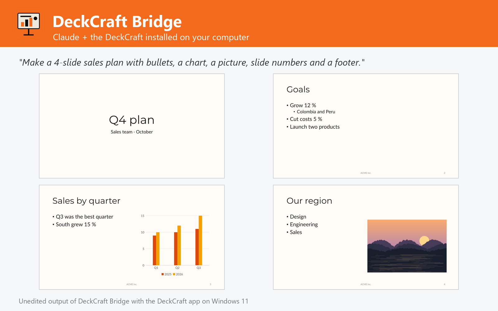

# DeckCraft Bridge

Create, edit and convert presentations with the DeckCraft app installed on Windows, macOS or Linux: slides with bullets, pictures, charts, tables and notes, themes, transitions, PowerPoint pptx, pdf and slide images. Not affiliated with DeckCraft or Storytold.



Make slide decks with the DeckCraft you already have installed on Windows, macOS or Linux (tested with 0.6.1 on Windows 11), the open-source, PowerPoint-class presentation app.

- **Create** presentations from a list of slides: title, subtitle, bullets with levels in one or two columns, pictures (kept in proportion), charts, tables, shapes and text boxes, speaker notes, backgrounds (text turns white on dark ones), transitions and bullet animations; or from a plain outline.
- **Design** with 8 themes, colour and font schemes, widescreen or 4:3 slides, slide numbers and footers.
- **Edit** existing PowerPoint files: find and replace (titles, text, table cells), add and delete slides, notes, themes and transitions.
- **Export** to PowerPoint pptx, pdf (slides, notes pages, handouts), png / jpeg per slide, deckcraft and outlines; every result returns pictures of the slides to check them.
- **Advanced**: run any of DeckCraft's 226 engine commands and open decks in the DeckCraft app.

## Requirements

- **DeckCraft** installed on Windows, macOS or Linux, with its command-line engine `deckcraft-cli` ([DeckCraft releases](https://github.com/storytold/deckcraft/releases); on macOS also the separate `deckcraft-cli` zip). The plugin finds it in the standard install folders or on `PATH`; otherwise set its folder in the plugin settings.
- **Node.js 20 or later** on `PATH` (the plugin's MCP server runs with `node`).
- Claude Code or another Claude app that runs local MCP servers from plugins.

## Tools

| Tool | What it does |
| --- | --- |
| `create_presentation` | Build a deck from slides: bullets, pictures, charts, tables, notes, themes |
| `edit_presentation` | Find and replace, add or delete slides, notes and themes in pptx files |
| `convert_presentation` | Convert to pptx, pdf (slides, notes, handouts), png / jpeg or outline |
| `get_presentation_info` | Slides, shapes, text, tables, charts, notes, spelling and accessibility |
| `render_slides` | Pictures of slides, optionally saved as PNG |
| `list_deckcraft_catalog` | Engine commands, themes, layouts, shapes, transitions and animations |
| `run_deckcraft_commands` | Run any DeckCraft engine command, headless or in the live app |
| `open_in_deckcraft` | Open presentations in the DeckCraft app |
| `get_deckcraft_status` | Check the DeckCraft installation, version and commands |

## Settings

All settings are optional; leave them empty to auto-detect.

| Setting | Title | Meaning |
| --- | --- | --- |
| `deckcraft_dir` | DeckCraft folder | Install folder of DeckCraft (or DeckCraft.app on macOS). Leave empty to auto-detect: C:\Program Files\DeckCraft, /Applications/DeckCraft.app, /usr/bin, /opt/deckcraft or PATH. |
| `deckcraft_cli` | deckcraft-cli executable (optional) | Only if it is somewhere else, e.g. where you unzipped the deckcraft-cli zip on macOS. |
| `control_port` | DeckCraft control port (optional) | Port used to drive the DeckCraft app (open_in_deckcraft, run_deckcraft_commands live). Default 7990. |

## What this plugin runs, reads and sends

- It starts one **local MCP server**: `node ${CLAUDE_PLUGIN_ROOT}/dist/bundle.cjs`. `dist/bundle.cjs` is the readable, unminified build of [jhonsu01/deckcraft-mcp-server](https://github.com/jhonsu01/deckcraft-mcp-server) version 1.0.0 (source code, tests and changelog are in that repository).
- The server runs the **DeckCraft engine installed on your computer** (`deckcraft-cli`) as a child process, one private engine per job in a temporary folder that is deleted afterwards. Only with `open_in_deckcraft` does it start the DeckCraft desktop app; with `control=true` that app listens on a loopback-only port on your own machine (`127.0.0.1`).
- It **reads only the files you name** (absolute paths) and **writes new files only where you ask**, never overwriting an existing file unless you set `overwrite: true`.
- It makes **no network requests**, sends no telemetry and stores no data. Its environment variables are only the settings above (`DECKCRAFT_DIR`, `DECKCRAFT_CLI`, `DECKCRAFT_CONTROL_PORT`).
- It installs nothing and runs no package manager: everything it needs is in this folder.

## Install

In Claude Code:

```
/plugin marketplace add jhonsu01/sunsam-plugins
/plugin install deckcraft-bridge@sunsam-plugins
```

The same connector is also available as a Claude Desktop extension (`.mcpb`), for Codex and DeepSeek Harness, and in the Sunsam Code marketplace: see [jhonsu01/deckcraft-mcp-server](https://github.com/jhonsu01/deckcraft-mcp-server).

## Support

Issues and questions: [https://github.com/jhonsu01/deckcraft-mcp-server/issues](https://github.com/jhonsu01/deckcraft-mcp-server/issues). Privacy: [PRIVACY.md](https://github.com/jhonsu01/sunsam-plugins/blob/main/PRIVACY.md).

## License

Apache-2.0. DeckCraft is an open-source project by Storytold (MIT or Apache-2.0). This plugin is a community project by Jhon Supelano; it is not affiliated with or endorsed by DeckCraft, Storytold or Anthropic.
