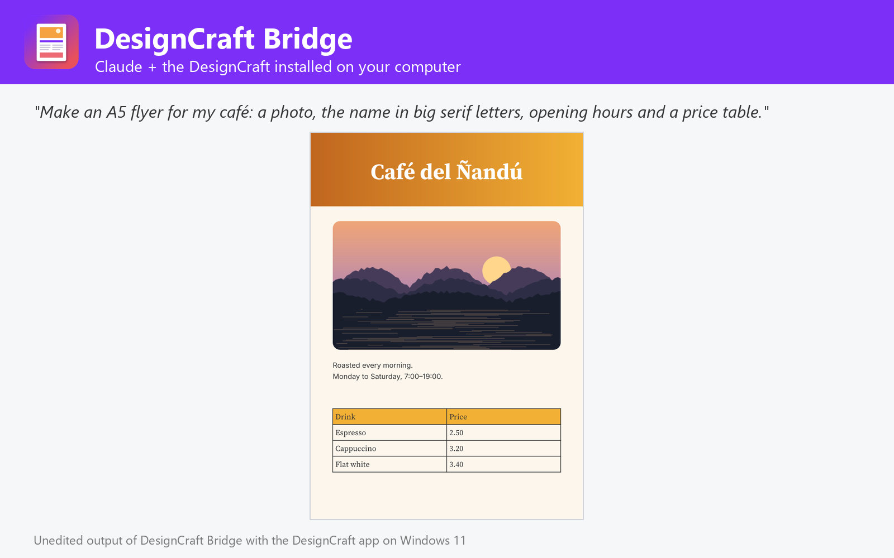

# DesignCraft Bridge

Lay out flyers, posters, brochures, menus, cards, certificates and book pages, mail-merge CSV data, edit .designcraft and InDesign .idml documents and export print-ready PDF (PDF/X-4), PNG, IDML, EPUB and HTML, using the DesignCraft publishing app installed on Windows, macOS or Linux. Not affiliated with DesignCraft or Storytold.



DesignCraft Bridge lets Claude do page layout with the DesignCraft you already have installed on Windows, macOS or Linux (tested with 0.5.0), the open-source, InDesign-class desktop publishing app.

- **Create layouts**: flyers, posters, brochures, menus, business cards, certificates, newsletters, reports and book pages from text frames (fonts, sizes, colours, alignment, columns, paragraph styles), images (fill or fit), rectangles, ellipses, polygons and lines (fills, gradients, strokes, rounded corners, opacity, drop shadows, text wrap) and tables. Sizes in pt, mm, cm, in or px; any page size or preset, facing pages, margins, columns and bleed.
- **Data merge**: one page per record (letters, certificates, invitations, badges) or several records per page (labels, business cards) from a CSV or a list of rows, with <<Field>> text and pictures whose paths come from the data.
- **Edit documents**: find / change (also GREP), replace stories, swap images, replace fonts, add pages and items in .designcraft or InDesign .idml files, written as a new copy.
- **Export**: PDF with page ranges, PDF/X-4 or PDF/A-2b, bleed, crop marks, spreads and tags; PNG / JPG pages at any dpi; IDML; reflowable or fixed EPUB; HTML; booklet PDFs; and packages with links, fonts and a report.
- **Inspect and automate**: pages, items, stories and overset text, styles, swatches, fonts, links and preflight issues; page previews; any of the 444 engine commands, headless or in the open app.

## Requirements

- **DesignCraft** installed on Windows, macOS or Linux, with its command-line engine `designcraft-cli` ([DesignCraft releases](https://github.com/storytold/designcraft/releases); on macOS also the separate `designcraft-cli` zip). The plugin finds it in the standard install folders or on `PATH`; otherwise set its folder in the plugin settings.
- **Node.js 20 or later** on `PATH` (the plugin's MCP server runs with `node`).
- Claude Code or another Claude app that runs local MCP servers from plugins.

## Tools

| Tool | What it does |
| --- | --- |
| `create_layout` | Lay out pages from text, images, shapes, lines and tables → PDF, PNG, IDML... |
| `data_merge` | Mail-merge a CSV into a template: letters, certificates, badges, labels |
| `export_document` | Export .designcraft / .idml to PDF/X, PNG, JPG, IDML, EPUB, HTML, booklet, package |
| `edit_document` | Find / change, replace text, images and fonts, add pages and items |
| `get_document_info` | Pages, items, stories, styles, fonts, links and preflight of a document |
| `render_pages` | See pages of a document |
| `list_designcraft_catalog` | Commands, page presets, fonts, formats |
| `run_designcraft_commands` | Run any DesignCraft engine commands, headless or live |
| `open_in_designcraft` | Open documents in the DesignCraft app |
| `get_designcraft_status` | Check the DesignCraft installation and version |

## Settings

All settings are optional; leave them empty to auto-detect.

| Setting | Title | Meaning |
| --- | --- | --- |
| `designcraft_dir` | DesignCraft folder | Install folder of DesignCraft (or DesignCraft.app on macOS). Leave empty to auto-detect: C:\Program Files\DesignCraft, /Applications/DesignCraft.app, /usr/bin, /opt/designcraft or PATH. |
| `designcraft_cli` | designcraft-cli executable (optional) | Only if it is somewhere else, e.g. where you unzipped designcraft-cli-<version>-macos-universal.zip on macOS. |
| `control_port` | DesignCraft control port (optional) | Port used to drive the DesignCraft app (live mode). Default 7981. |

## What this plugin runs, reads and sends

- It starts one **local MCP server**: `node ${CLAUDE_PLUGIN_ROOT}/dist/bundle.cjs`. `dist/bundle.cjs` is the readable, unminified build of [jhonsu01/designcraft-mcp-server](https://github.com/jhonsu01/designcraft-mcp-server) version 1.0.4 (source code, tests and changelog are in that repository).
- The server runs the **DesignCraft engine installed on your computer** (`designcraft-cli`) as a child process, one private engine per job in a temporary folder that is deleted afterwards. Only with `open_in_designcraft` does it start the DesignCraft desktop app; with `control=true` that app listens on a loopback-only port on your own machine (`127.0.0.1`).
- It **reads only the files you name** (absolute paths) and **writes new files only where you ask**, never overwriting an existing file unless you set `overwrite: true`.
- It makes **no network requests**, sends no telemetry and stores no data. Its environment variables are only the settings above (`DESIGNCRAFT_DIR`, `DESIGNCRAFT_CLI`, `DESIGNCRAFT_CONTROL_PORT`).
- It installs nothing and runs no package manager: everything it needs is in this folder.

## Install

In Claude Code:

```
/plugin marketplace add jhonsu01/sunsam-plugins
/plugin install designcraft-bridge@sunsam-plugins
```

The same connector is also available as a Claude Desktop extension (`.mcpb`), for Codex and DeepSeek Harness, and in the Sunsam Code marketplace: see [jhonsu01/designcraft-mcp-server](https://github.com/jhonsu01/designcraft-mcp-server).

## Support

Issues and questions: [https://github.com/jhonsu01/designcraft-mcp-server/issues](https://github.com/jhonsu01/designcraft-mcp-server/issues). Privacy: [PRIVACY.md](https://github.com/jhonsu01/sunsam-plugins/blob/main/PRIVACY.md).

## License

Apache-2.0. DesignCraft is an open-source project by Storytold (MIT or Apache-2.0). This plugin is a community project by Jhon Supelano; it is not affiliated with or endorsed by DesignCraft, Storytold or Anthropic.
