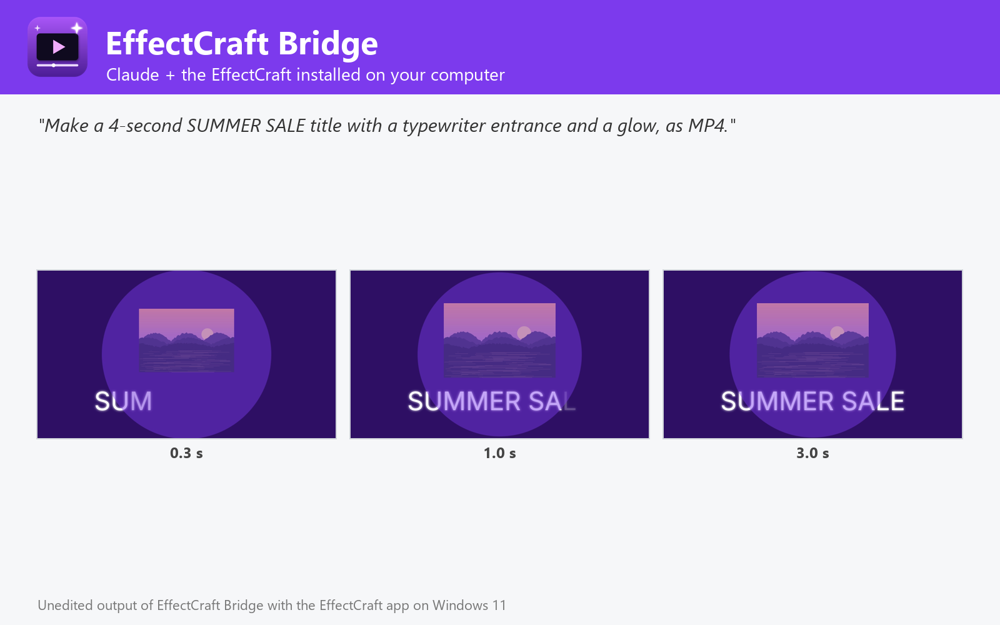

# EffectCraft Bridge

Create motion graphics, animated titles and visual effects (text, shapes, media, keyframes, expressions, 306 effects, templates) and render MP4, ProRes, WebM, GIF, image sequences and Lottie, using the EffectCraft compositor installed on Windows, macOS or Linux. Not affiliated with EffectCraft or Storytold.



EffectCraft Bridge lets Claude make motion graphics with the EffectCraft you already have installed on Windows, macOS or Linux (tested with 0.7.0), the open-source, After Effects-class compositor written in Rust.

- **Create**: animated titles, intros, social clips, lower thirds and logo animations from layers — text with any font, shapes, solids, images, videos and audio — with ready-made entrances and exits (fade, slide, pop, zoom, blur, typewriter, spin), keyframes, After Effects-style expressions and any of the 306 effects (Glow, Gaussian Blur, Drop Shadow, Curves, Lumetri Color, Fractal Noise, CC Particle World...).
- **Add effects to videos**: colour grading, blur, glow, stylize, distort, trims and speed changes, and animated titles and logos on top, one file or a whole folder.
- **Templates**: Lower Third, Title Card, Logo Reveal, Kinetic Type, Social Square, Vertical Story, Slideshow and 3D Text Orbit, or your own .ectemplate, with your texts, colours and background footage.
- **Render**: MP4 (H.264), HEVC, AV1, ProRes (with alpha), WebM, GIF, PNG / JPEG / TIFF / EXR sequences, WAV, Lottie, and the editable .ecproj.
- **Projects and scripts**: render any comp of an .ecproj, inspect projects, preview frames, run After Effects-style JavaScript and any of the 665 engine commands, headless or in the open app.

## Requirements

- **EffectCraft** installed on Windows, macOS or Linux, with its command-line engine `effectcraft-cli` ([EffectCraft releases](https://github.com/storytold/effectcraft/releases); on macOS also the separate `effectcraft-cli` zip). The plugin finds it in the standard install folders or on `PATH`; otherwise set its folder in the plugin settings.
- **Node.js 20 or later** on `PATH` (the plugin's MCP server runs with `node`).
- Claude Code or another Claude app that runs local MCP servers from plugins.

## Tools

| Tool | What it does |
| --- | --- |
| `create_motion_graphic` | Animated titles and designs from layers, effects and keyframes → video |
| `apply_effects` | Effects, trims, speed and titles on videos and images |
| `use_template` | Fill in a motion template (lower third, title card, social...) and render |
| `render_project` | Render a comp of an .ecproj to video, GIF, frames or Lottie |
| `get_project_info` | Comps, layers, footage and template controls of a project |
| `render_frame` | See frames of a project or a video |
| `list_effectcraft_catalog` | Effects, templates, fonts, commands, formats |
| `run_effectcraft_script` | Run After Effects-style JavaScript, then render |
| `run_effectcraft_commands` | Run any EffectCraft engine commands, headless or live |
| `open_in_effectcraft` | Open projects or media in the EffectCraft app |
| `get_effectcraft_status` | Check the EffectCraft installation and version |

## Settings

All settings are optional; leave them empty to auto-detect.

| Setting | Title | Meaning |
| --- | --- | --- |
| `effectcraft_dir` | EffectCraft folder | Install folder of EffectCraft (or EffectCraft.app on macOS). Leave empty to auto-detect: C:\Program Files\EffectCraft, /Applications/EffectCraft.app, /usr/bin, /opt/effectcraft or PATH. |
| `effectcraft_cli` | effectcraft-cli executable (optional) | Only if it is somewhere else, e.g. where you unzipped effectcraft-cli-<version>-macos-universal.zip on macOS. |
| `control_port` | EffectCraft control port (optional) | Port used to drive the EffectCraft app (live mode). Default 9877. |

## What this plugin runs, reads and sends

- It starts one **local MCP server**: `node ${CLAUDE_PLUGIN_ROOT}/dist/bundle.cjs`. `dist/bundle.cjs` is the readable, unminified build of [jhonsu01/effectcraft-mcp-server](https://github.com/jhonsu01/effectcraft-mcp-server) version 1.0.5 (source code, tests and changelog are in that repository).
- The server runs the **EffectCraft engine installed on your computer** (`effectcraft-cli`) as a child process, one private engine per job in a temporary folder that is deleted afterwards. Only with `open_in_effectcraft` does it start the EffectCraft desktop app; with `control=true` that app listens on a loopback-only port on your own machine (`127.0.0.1`).
- It **reads only the files you name** (absolute paths) and **writes new files only where you ask**, never overwriting an existing file unless you set `overwrite: true`.
- It makes **no network requests**, sends no telemetry and stores no data. Its environment variables are only the settings above (`EFFECTCRAFT_DIR`, `EFFECTCRAFT_CLI`, `EFFECTCRAFT_CONTROL_PORT`).
- It installs nothing and runs no package manager: everything it needs is in this folder.

## Install

In Claude Code:

```
/plugin marketplace add jhonsu01/sunsam-plugins
/plugin install effectcraft-bridge@sunsam-plugins
```

The same connector is also available as a Claude Desktop extension (`.mcpb`), for Codex and DeepSeek Harness, and in the Sunsam Code marketplace: see [jhonsu01/effectcraft-mcp-server](https://github.com/jhonsu01/effectcraft-mcp-server).

## Support

Issues and questions: [https://github.com/jhonsu01/effectcraft-mcp-server/issues](https://github.com/jhonsu01/effectcraft-mcp-server/issues). Privacy: [PRIVACY.md](https://github.com/jhonsu01/sunsam-plugins/blob/main/PRIVACY.md).

## License

Apache-2.0. EffectCraft is an open-source project by Storytold (MIT or Apache-2.0). This plugin is a community project by Jhon Supelano; it is not affiliated with or endorsed by EffectCraft, Storytold or Anthropic.
