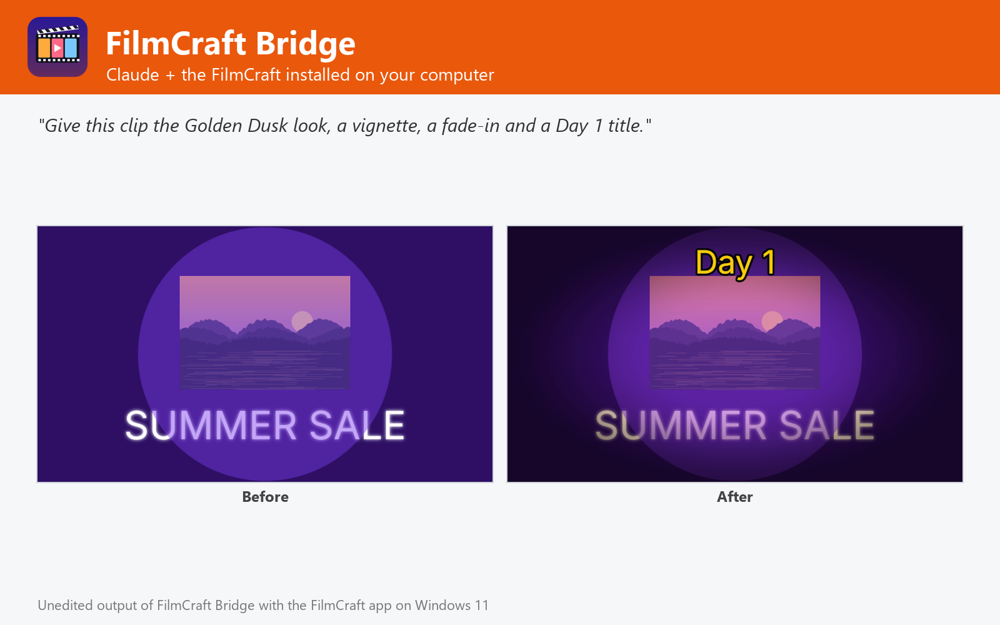

# FilmCraft Bridge

Split, trim, edit (effects, color looks, titles, speed, audio), join, convert and export video with the FilmCraft editor installed on Windows, macOS or Linux, and keep every edit editable. Not affiliated with FilmCraft or Storytold.



FilmCraft Bridge lets Claude edit video with the FilmCraft you already have installed on Windows, macOS or Linux (tested with 0.2.1 on Windows 11 and Debian 12), the open-source, Premiere-class editor written in Rust.

- **Split** videos into N-second pieces, frame-accurate, one folder per input.
- **Edit**: 130 video effects with parameters and keyframes (blur, glow, vignette, RGB split, camera shake, light leaks...), 18 Lumetri color looks, burned-in titles with font, color, outline, background and animation, speed / reverse, 58 audio effects, volume and fades.
- **Join** clips, stills and audio with 112 transitions.
- **Convert / export**: H.264 MP4, ProRes, DNxHR, MJPEG, MXF, GIF, PNG/TIFF stills, WAV/AIFF, with 28 presets (YouTube, Vimeo, Social Vertical, broadcast...).
- **Editable outputs**: the FilmCraft project (.fcproj) plus OpenTimelineIO, FCPXML, Premiere XML, EDL and AAF for other editors.
- **Preview** any frame, run any of FilmCraft's 666 engine commands, and open results in the FilmCraft app.

## Requirements

- **FilmCraft** installed on Windows, macOS or Linux, with its command-line engine `filmcraft-cli` ([FilmCraft releases](https://github.com/storytold/filmcraft/releases); on macOS also the separate `filmcraft-cli` zip). The plugin finds it in the standard install folders or on `PATH`; otherwise set its folder in the plugin settings.
- **Node.js 20 or later** on `PATH` (the plugin's MCP server runs with `node`).
- Claude Code or another Claude app that runs local MCP servers from plugins.

## Tools

| Tool | What it does |
| --- | --- |
| `split_video` | Cut one or many videos into N-second pieces, one folder per input |
| `edit_video` | Effects, Lumetri color look, titles, speed, audio effects and fades on one or many files |
| `trim_video` | Keep a time range of a file, with optional fades |
| `concat_videos` | Join videos, stills and audio with transitions |
| `convert_media` | Re-export with another codec, size, frame rate, preset, or extract the audio |
| `get_media_info` | Container, duration, codecs, size, frame rate and audio of a file |
| `render_frame` | Render one frame of a file or project to PNG |
| `list_catalog` | Effects, transitions, color looks, export presets and engine commands |
| `run_commands` | Run any FilmCraft engine command, headless or in the live app |
| `open_in_filmcraft` | Open projects or media in the FilmCraft app |
| `get_filmcraft_status` | Check the FilmCraft installation, version and catalog |

## Settings

All settings are optional; leave them empty to auto-detect.

| Setting | Title | Meaning |
| --- | --- | --- |
| `filmcraft_dir` | FilmCraft folder | Install folder of FilmCraft (or FilmCraft.app on macOS). Leave empty to auto-detect: C:\Program Files\FilmCraft, /Applications/FilmCraft.app, /usr/bin, /opt/filmcraft or PATH. |
| `filmcraft_cli` | filmcraft-cli executable (optional) | Only if it is somewhere else, e.g. where you unzipped filmcraft-cli-<version>-macos.zip on macOS. |
| `control_port` | FilmCraft control port (optional) | Port used to drive the FilmCraft app (open_in_filmcraft, run_commands live). Default 9876. |

## What this plugin runs, reads and sends

- It starts one **local MCP server**: `node ${CLAUDE_PLUGIN_ROOT}/dist/bundle.cjs`. `dist/bundle.cjs` is the readable, unminified build of [jhonsu01/filmcraft-mcp-server](https://github.com/jhonsu01/filmcraft-mcp-server) version 1.1.4 (source code, tests and changelog are in that repository).
- The server runs the **FilmCraft engine installed on your computer** (`filmcraft-cli`) as a child process, one private engine per job in a temporary folder that is deleted afterwards. Only with `open_in_filmcraft` does it start the FilmCraft desktop app; with `control=true` that app listens on a loopback-only port on your own machine (`127.0.0.1`).
- It **reads only the files you name** (absolute paths) and **writes new files only where you ask**, never overwriting an existing file unless you set `overwrite: true`.
- It makes **no network requests**, sends no telemetry and stores no data. Its environment variables are only the settings above (`FILMCRAFT_DIR`, `FILMCRAFT_CLI`, `FILMCRAFT_CONTROL_PORT`).
- It installs nothing and runs no package manager: everything it needs is in this folder.

## Install

In Claude Code:

```
/plugin marketplace add jhonsu01/sunsam-plugins
/plugin install filmcraft-bridge@sunsam-plugins
```

The same connector is also available as a Claude Desktop extension (`.mcpb`), for Codex and DeepSeek Harness, and in the Sunsam Code marketplace: see [jhonsu01/filmcraft-mcp-server](https://github.com/jhonsu01/filmcraft-mcp-server).

## Support

Issues and questions: [https://github.com/jhonsu01/filmcraft-mcp-server/issues](https://github.com/jhonsu01/filmcraft-mcp-server/issues). Privacy: [PRIVACY.md](https://github.com/jhonsu01/sunsam-plugins/blob/main/PRIVACY.md).

## License

Apache-2.0. FilmCraft is an open-source project by Storytold (MIT or Apache-2.0). This plugin is a community project by Jhon Supelano; it is not affiliated with or endorsed by FilmCraft, Storytold or Anthropic.
