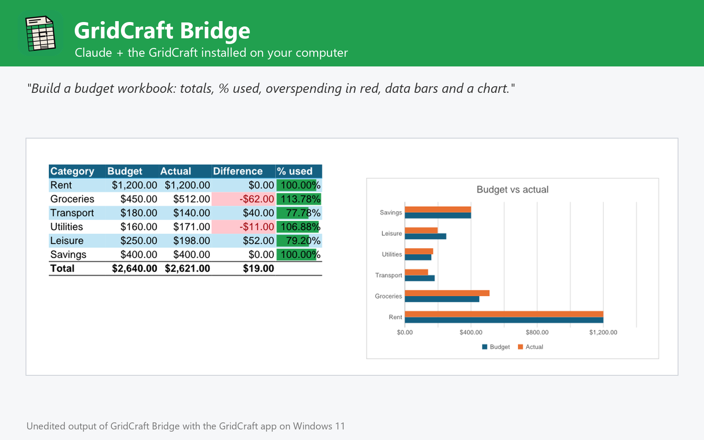

# GridCraft Bridge

Build, edit, read and convert spreadsheets with the GridCraft app installed on Windows, macOS or Linux: sheets with live formulas, tables, formats, conditional formatting, charts and PivotTables, xlsx, csv, json, html and pdf. Not affiliated with GridCraft or Storytold.



Work on spreadsheets with the GridCraft you already have installed on Windows, macOS or Linux (tested with 0.6.1 on Windows 11), the open-source, Excel-class spreadsheet app.

- **Create** workbooks from sheets of values and live formulas (513 Excel functions, dynamic arrays): header styling, tables with filter buttons, totals rows, number formats, fonts, colours, borders, merged cells, conditional formatting, drop-down lists, notes, charts (17 types), PivotTables, frozen panes and print setup.
- **Edit** existing xlsx, ods or csv files: write values and formulas, find and replace, insert and delete rows and columns, sort, remove duplicates, add, rename or delete sheets.
- **Read and calculate**: computed values, formulas or display text of any range, and formulas evaluated without changing the file; every result shows the first rows and any formula errors.
- **Convert** between xlsx, xlsm, xls, xlsb, ods, csv, tsv and json in, and xlsx, csv, tsv, json, html and pdf out.
- **Advanced**: run any of GridCraft's 339 engine commands and open workbooks in the GridCraft app.

## Requirements

- **GridCraft** installed on Windows, macOS or Linux, with its command-line engine `gridcraft-cli` ([GridCraft releases](https://github.com/storytold/gridcraft/releases); on macOS also the separate `gridcraft-cli` zip). The plugin finds it in the standard install folders or on `PATH`; otherwise set its folder in the plugin settings.
- **Node.js 20 or later** on `PATH` (the plugin's MCP server runs with `node`).
- Claude Code or another Claude app that runs local MCP servers from plugins.

## Tools

| Tool | What it does |
| --- | --- |
| `create_workbook` | Build a workbook: data, formulas, tables, formats, charts, PivotTables |
| `edit_workbook` | Write cells, find and replace, sort, rows, sheets, formats and charts |
| `read_workbook` | Read computed values or formulas and evaluate formulas |
| `convert_workbook` | Convert between xlsx, ods, csv, tsv, json, html and pdf |
| `get_workbook_info` | Sheets, tables, charts, names, first rows and formula errors |
| `list_gridcraft_catalog` | Engine commands, worksheet functions, chart types and formats |
| `run_gridcraft_commands` | Run any GridCraft engine command, headless or in the live app |
| `open_in_gridcraft` | Open workbooks in the GridCraft app |
| `get_gridcraft_status` | Check the GridCraft installation, version and commands |

## Settings

All settings are optional; leave them empty to auto-detect.

| Setting | Title | Meaning |
| --- | --- | --- |
| `gridcraft_dir` | GridCraft folder | Install folder of GridCraft (or GridCraft.app on macOS). Leave empty to auto-detect: C:\Program Files\GridCraft, /Applications/GridCraft.app, /usr/bin, /opt/gridcraft or PATH. |
| `gridcraft_cli` | gridcraft-cli executable (optional) | Only if it is somewhere else, e.g. where you unzipped the gridcraft-cli zip on macOS. |
| `control_port` | GridCraft control port (optional) | Port used to drive the GridCraft app (open_in_gridcraft, run_gridcraft_commands live). Default 7979. |

## What this plugin runs, reads and sends

- It starts one **local MCP server**: `node ${CLAUDE_PLUGIN_ROOT}/dist/bundle.cjs`. `dist/bundle.cjs` is the readable, unminified build of [jhonsu01/gridcraft-mcp-server](https://github.com/jhonsu01/gridcraft-mcp-server) version 1.0.0 (source code, tests and changelog are in that repository).
- The server runs the **GridCraft engine installed on your computer** (`gridcraft-cli`) as a child process, one private engine per job in a temporary folder that is deleted afterwards. Only with `open_in_gridcraft` does it start the GridCraft desktop app; with `control=true` that app listens on a loopback-only port on your own machine (`127.0.0.1`).
- It **reads only the files you name** (absolute paths) and **writes new files only where you ask**, never overwriting an existing file unless you set `overwrite: true`.
- It makes **no network requests**, sends no telemetry and stores no data. Its environment variables are only the settings above (`GRIDCRAFT_DIR`, `GRIDCRAFT_CLI`, `GRIDCRAFT_CONTROL_PORT`).
- It installs nothing and runs no package manager: everything it needs is in this folder.

## Install

In Claude Code:

```
/plugin marketplace add jhonsu01/sunsam-plugins
/plugin install gridcraft-bridge@sunsam-plugins
```

The same connector is also available as a Claude Desktop extension (`.mcpb`), for Codex and DeepSeek Harness, and in the Sunsam Code marketplace: see [jhonsu01/gridcraft-mcp-server](https://github.com/jhonsu01/gridcraft-mcp-server).

## Support

Issues and questions: [https://github.com/jhonsu01/gridcraft-mcp-server/issues](https://github.com/jhonsu01/gridcraft-mcp-server/issues). Privacy: [PRIVACY.md](https://github.com/jhonsu01/sunsam-plugins/blob/main/PRIVACY.md).

## License

Apache-2.0. GridCraft is an open-source project by Storytold (MIT or Apache-2.0). This plugin is a community project by Jhon Supelano; it is not affiliated with or endorsed by GridCraft, Storytold or Anthropic.
