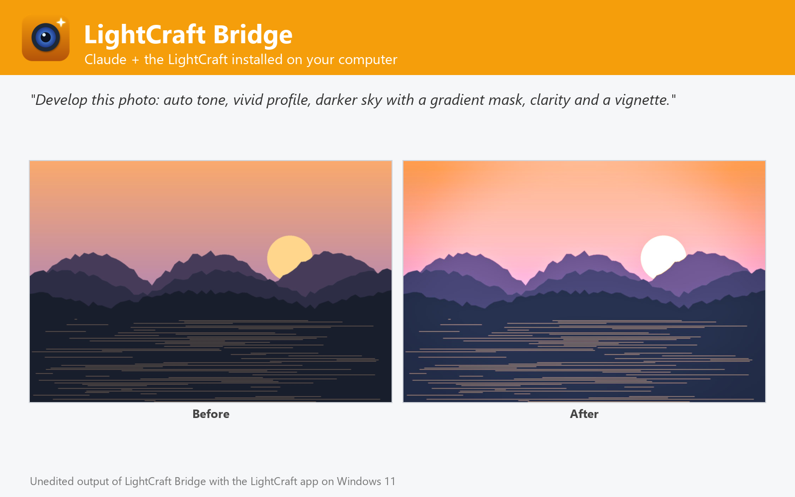

# LightCraft Bridge

Develop photos and raw files (auto tone, white balance, 114 sliders, presets, profiles, masks, spot healing, crop), merge HDR and panoramas, cull by sharpness and export JPEG, TIFF, WebP, AVIF or DNG, using the LightCraft raw developer installed on Windows, macOS or Linux. Not affiliated with LightCraft or Storytold.



LightCraft Bridge lets Claude develop your photos with the LightCraft you already have installed on Windows, macOS or Linux (tested with 0.4.0), the open-source, Lightroom-class raw developer written in Rust.

- **Develop**: raw (DNG, CR2, CR3, ARW, NEF, RAF, RW2, PEF, ORF, SRW) and JPEG / TIFF / PNG photos with auto tone, white balance (presets, Kelvin, eyedropper), any of the 114 develop sliders (exposure, contrast, highlights, shadows, texture, clarity, dehaze, vibrance, colour mixer, colour grading, tone curve, vignette, grain, sharpening, noise reduction, lens corrections), presets and profiles (Lightroom .xmp / .lrtemplate presets too), black & white, crop and straighten, upright, spot healing, dust and red-eye removal, and masks (graduated, radial, luminance, colour, brush, subject, sky) with local adjustments. One photo or whole folders.
- **Merge**: HDR from brackets, panoramas and HDR panoramas, as editable DNG.
- **Cull**: score a shoot for focus and clipping, group bursts and keep the sharpest.
- **Export**: JPEG, PNG, TIFF, WebP, AVIF and DNG with size, quality, file-size limit, colour space, bit depth, output sharpening, metadata policy and watermark.
- **Preview** any photo with a trial look, and run any of LightCraft's 240 commands, headless or in the open app.

## Requirements

- **LightCraft** installed on Windows, macOS or Linux, with its command-line engine `lightcraft-cli` ([LightCraft releases](https://github.com/storytold/lightcraft/releases); on macOS also the separate `lightcraft-cli` zip). The plugin finds it in the standard install folders or on `PATH`; otherwise set its folder in the plugin settings.
- **Node.js 20 or later** on `PATH` (the plugin's MCP server runs with `node`).
- Claude Code or another Claude app that runs local MCP servers from plugins.

## Tools

| Tool | What it does |
| --- | --- |
| `develop_photos` | Auto tone, white balance, sliders, presets, masks, healing, crop → export |
| `convert_photos` | Raw and photos to JPEG, PNG, TIFF, WebP, AVIF, DNG, resized, in batches |
| `render_preview` | See a photo, optionally with a trial look |
| `get_photo_info` | Camera, lens, exposure, GPS, size and every EXIF / XMP tag |
| `merge_photos` | HDR, panorama and HDR panorama as editable DNG |
| `analyze_photos` | Cull a shoot: focus and clipping scores, best of each burst |
| `list_lightcraft_catalog` | Develop controls, presets, profiles, curves, commands, formats |
| `run_lightcraft_commands` | Run any LightCraft engine commands, headless or in the live app |
| `open_in_lightcraft` | Open photos in the LightCraft app |
| `get_lightcraft_status` | Check the LightCraft installation and version |

## Settings

All settings are optional; leave them empty to auto-detect.

| Setting | Title | Meaning |
| --- | --- | --- |
| `lightcraft_dir` | LightCraft folder | Install folder of LightCraft (or LightCraft.app on macOS). Leave empty to auto-detect: C:\Program Files\LightCraft, /Applications/LightCraft.app, /usr/bin, /opt/lightcraft or PATH. |
| `lightcraft_cli` | lightcraft-cli executable (optional) | Only if it is somewhere else, e.g. where you unzipped lightcraft-cli-<version>-macos-universal.zip on macOS. |
| `control_port` | LightCraft control port (optional) | Port used to drive the LightCraft app (run_lightcraft_commands live). Default 7980. |

## What this plugin runs, reads and sends

- It starts one **local MCP server**: `node ${CLAUDE_PLUGIN_ROOT}/dist/bundle.cjs`. `dist/bundle.cjs` is the readable, unminified build of [jhonsu01/lightcraft-mcp-server](https://github.com/jhonsu01/lightcraft-mcp-server) version 1.0.3 (source code, tests and changelog are in that repository).
- The server runs the **LightCraft engine installed on your computer** (`lightcraft-cli`) as a child process, one private engine per job in a temporary folder that is deleted afterwards. Only with `open_in_lightcraft` does it start the LightCraft desktop app; with `control=true` that app listens on a loopback-only port on your own machine (`127.0.0.1`).
- It **reads only the files you name** (absolute paths) and **writes new files only where you ask**, never overwriting an existing file unless you set `overwrite: true`.
- It makes **no network requests**, sends no telemetry and stores no data. Its environment variables are only the settings above (`LIGHTCRAFT_DIR`, `LIGHTCRAFT_CLI`, `LIGHTCRAFT_CONTROL_PORT`).
- It installs nothing and runs no package manager: everything it needs is in this folder.

## Install

In Claude Code:

```
/plugin marketplace add jhonsu01/sunsam-plugins
/plugin install lightcraft-bridge@sunsam-plugins
```

The same connector is also available as a Claude Desktop extension (`.mcpb`), for Codex and DeepSeek Harness, and in the Sunsam Code marketplace: see [jhonsu01/lightcraft-mcp-server](https://github.com/jhonsu01/lightcraft-mcp-server).

## Support

Issues and questions: [https://github.com/jhonsu01/lightcraft-mcp-server/issues](https://github.com/jhonsu01/lightcraft-mcp-server/issues). Privacy: [PRIVACY.md](https://github.com/jhonsu01/sunsam-plugins/blob/main/PRIVACY.md).

## License

Apache-2.0. LightCraft is an open-source project by Storytold (MIT or Apache-2.0). This plugin is a community project by Jhon Supelano; it is not affiliated with or endorsed by LightCraft, Storytold or Anthropic.
