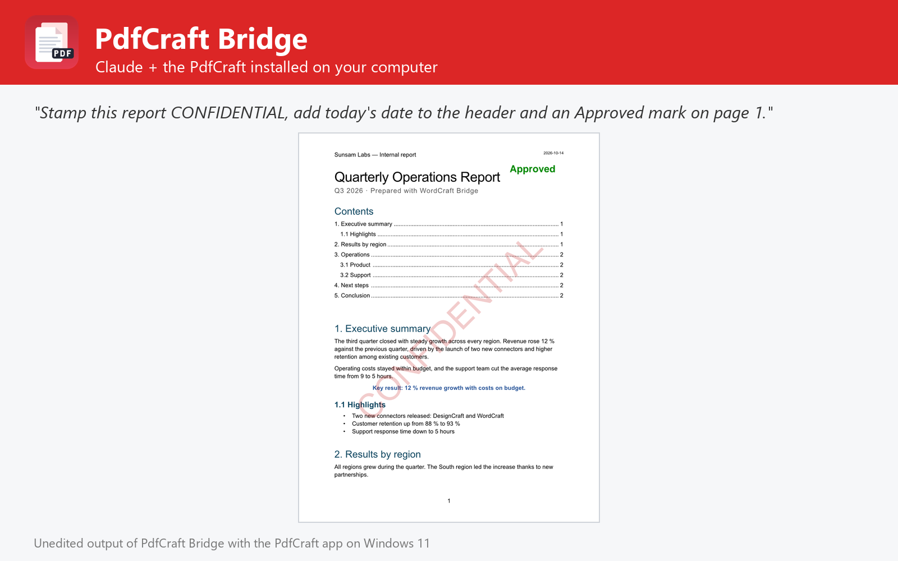

# PdfCraft Bridge

Read, split, merge, organize, watermark, protect, redact, fill, sign, convert, compress and OCR PDFs with the PdfCraft editor installed on Windows, macOS or Linux. Not affiliated with PdfCraft or Storytold.



PdfCraft Bridge lets Claude work on PDFs with the PdfCraft you already have installed on Windows, macOS or Linux (tested with 0.4.0), the open-source, Acrobat-class editor written in Rust.

- **Read**: document info, page sizes, fonts, security, signatures; text by page; pages as PNG / JPEG / TIFF.
- **Pages**: split (every N pages, before pages, by bookmarks or size), merge with page ranges, extract, insert, duplicate, rotate, move, delete, crop, page labels, metadata.
- **Add**: text and picture watermarks, headers and footers with page numbers and Bates numbers, backgrounds, text boxes, images, links.
- **Secure**: passwords and permissions (AES-256), true redaction of words, patterns (email, phone, SSN, card, dates) and areas, hidden-information removal, digital signatures.
- **Forms**: list, auto-detect, fill and flatten.
- **Convert**: Word, HTML, RTF, text, images, PDF/A; create PDFs from images or text; reduce file size; OCR; compare versions.
- **Everything else**: run any of PdfCraft's 131 engine tools (comments, bookmarks, accessibility, measurements, JavaScript...).

## Requirements

- **PdfCraft** installed on Windows, macOS or Linux, with its command-line engine `pdfcraft-cli` ([PdfCraft releases](https://github.com/storytold/pdfcraft/releases); on macOS also the separate `pdfcraft-cli` zip). The plugin finds it in the standard install folders or on `PATH`; otherwise set its folder in the plugin settings.
- **Node.js 20 or later** on `PATH` (the plugin's MCP server runs with `node`).
- Claude Code or another Claude app that runs local MCP servers from plugins.

## Tools

| Tool | What it does |
| --- | --- |
| `get_pdf_info` | Pages, sizes, metadata, security, fields, fonts, signatures |
| `extract_text` | Text of some or all pages, optionally saved as .txt |
| `render_pages` | Pages as PNG, JPEG or TIFF images |
| `split_pdf` | Split by page count, page numbers, bookmarks or size |
| `merge_pdfs` | Combine PDFs with optional page ranges |
| `extract_pages` | Copy pages into a new PDF or one file per page |
| `edit_pages` | Insert, duplicate, rotate, move, delete, crop, label pages; metadata |
| `create_pdf` | New PDF from images, text or blank pages |
| `add_content` | Watermarks, headers/footers, backgrounds, text, images, links |
| `protect_pdf` | Add or remove passwords and permissions |
| `redact_pdf` | Permanently remove words, patterns, areas or pages |
| `fill_form` | List, detect, fill and flatten form fields |
| `sign_pdf` | Digitally sign with a .p12/.pfx ID |
| `convert_pdf` | To Word, HTML, RTF, text, images or PDF/A |
| `optimize_pdf` | Reduce file size, optionally removing hidden information |
| `ocr_pdf` | Make scanned PDFs searchable |
| `compare_pdfs` | Differences between two versions, with report |
| `list_pdf_tools` | The 131 PdfCraft engine tools and their schemas |
| `run_pdf_tools` | Run any PdfCraft engine tools in one session |
| `open_in_pdfcraft` | Open PDFs in the PdfCraft app |
| `get_pdfcraft_status` | Check the PdfCraft installation, version and OCR |

## Settings

All settings are optional; leave them empty to auto-detect.

| Setting | Title | Meaning |
| --- | --- | --- |
| `pdfcraft_dir` | PdfCraft folder | Install folder of PdfCraft (or PdfCraft.app on macOS). Leave empty to auto-detect: C:\Program Files\PdfCraft, /Applications/PdfCraft.app, /usr/bin, /opt/pdfcraft or PATH. |
| `pdfcraft_cli` | pdfcraft-cli executable (optional) | Only if it is somewhere else, e.g. where you unzipped pdfcraft-cli-<version>-macos-universal.zip on macOS. |
| `pdfcraft_root` | Limit access to this folder (optional) | When set, PdfCraft may only read and write files inside this folder. |

## What this plugin runs, reads and sends

- It starts one **local MCP server**: `node ${CLAUDE_PLUGIN_ROOT}/dist/bundle.cjs`. `dist/bundle.cjs` is the readable, unminified build of [jhonsu01/pdfcraft-mcp-server](https://github.com/jhonsu01/pdfcraft-mcp-server) version 1.0.3 (source code, tests and changelog are in that repository).
- The server runs the **PdfCraft engine installed on your computer** (`pdfcraft-cli`) as a child process, one private engine per job in a temporary folder that is deleted afterwards. Only with `open_in_pdfcraft` does it start the PdfCraft desktop app; with `control=true` that app listens on a loopback-only port on your own machine (`127.0.0.1`).
- It **reads only the files you name** (absolute paths) and **writes new files only where you ask**, never overwriting an existing file unless you set `overwrite: true`.
- It makes **no network requests**, sends no telemetry and stores no data. Its environment variables are only the settings above (`PDFCRAFT_DIR`, `PDFCRAFT_CLI`, `PDFCRAFT_ROOT`).
- It installs nothing and runs no package manager: everything it needs is in this folder.

## Install

In Claude Code:

```
/plugin marketplace add jhonsu01/sunsam-plugins
/plugin install pdfcraft-bridge@sunsam-plugins
```

The same connector is also available as a Claude Desktop extension (`.mcpb`), for Codex and DeepSeek Harness, and in the Sunsam Code marketplace: see [jhonsu01/pdfcraft-mcp-server](https://github.com/jhonsu01/pdfcraft-mcp-server).

## Support

Issues and questions: [https://github.com/jhonsu01/pdfcraft-mcp-server/issues](https://github.com/jhonsu01/pdfcraft-mcp-server/issues). Privacy: [PRIVACY.md](https://github.com/jhonsu01/sunsam-plugins/blob/main/PRIVACY.md).

## License

Apache-2.0. PdfCraft is an open-source project by Storytold (MIT or Apache-2.0). This plugin is a community project by Jhon Supelano; it is not affiliated with or endorsed by PdfCraft, Storytold or Anthropic.
