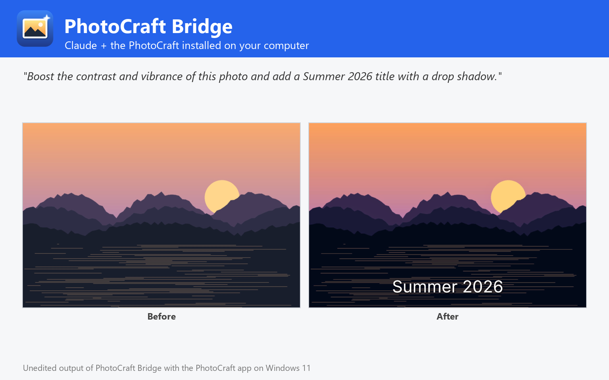

# PhotoCraft Bridge

Edit photos (resize, crop, adjustments, Camera Raw, filters, remove background, text, shapes, layer styles), create designs and convert between PSD, TIFF, PNG, JPEG, WebP, EXR and more, using the PhotoCraft editor installed on Windows, macOS or Linux. Not affiliated with PhotoCraft or Storytold.



PhotoCraft Bridge lets Claude edit images with the PhotoCraft you already have installed on Windows, macOS or Linux (tested with 0.5.0), the open-source, Photoshop-class editor written in Rust.

- **Edit**: resize, crop, canvas size, rotate, flip, trim, auto tone / contrast / colour, adjustments (levels, curves, exposure, hue/saturation, black & white, colour balance, photo filter, vibrance...) as pixels or editable adjustment layers, Camera Raw, and 122 filters (blur, sharpen, noise, distort, stylize, artistic gallery...). One image, a list or a whole folder.
- **Remove backgrounds**: cut out the subject to a transparent PNG, cropped or on a new colour, or keep the editable mask in a PSD.
- **Create**: social posts, banners, thumbnails and collages from fill and gradient layers, shapes, text with any font, placed photos and logos, and layer styles (drop shadow, stroke, glow, bevel...).
- **Convert**: PSD, PSB, layered or flat TIFF, PNG, JPEG, WebP, GIF, BMP, TGA, ICO, QOI, OpenEXR, HDR and the native .pcraft; reads HEIC, SVG and Affinity files too.
- **Preview** any file, inspect its layers, and run any of PhotoCraft's 817 commands, headless or in the open app.

## Requirements

- **PhotoCraft** installed on Windows, macOS or Linux, with its command-line engine `photocraft-cli` ([PhotoCraft releases](https://github.com/storytold/photocraft/releases); on macOS also the separate `photocraft-cli` zip). The plugin finds it in the standard install folders or on `PATH`; otherwise set its folder in the plugin settings.
- **Node.js 20 or later** on `PATH` (the plugin's MCP server runs with `node`).
- Claude Code or another Claude app that runs local MCP servers from plugins.

## Tools

| Tool | What it does |
| --- | --- |
| `get_image_info` | Size, mode, depth, resolution, layer tree, text and fonts |
| `convert_image` | Convert between PSD, TIFF, PNG, JPEG, WebP, EXR and more, in batches |
| `edit_image` | Resize, crop, adjustments, Camera Raw, filters, text, logos, styles |
| `create_image` | New designs from gradients, shapes, text, photos and layer styles |
| `remove_background` | Cut out the subject: transparent, trimmed or on a colour |
| `render_preview` | Render any image or document to PNG and show it |
| `list_photo_catalog` | Commands, filters, adjustments, layer styles, presets, formats |
| `run_photo_commands` | Run any PhotoCraft engine commands, headless or in the live app |
| `open_in_photocraft` | Open images in the PhotoCraft app |
| `get_photocraft_status` | Check the PhotoCraft installation and version |

## Settings

All settings are optional; leave them empty to auto-detect.

| Setting | Title | Meaning |
| --- | --- | --- |
| `photocraft_dir` | PhotoCraft folder | Install folder of PhotoCraft (or PhotoCraft.app on macOS). Leave empty to auto-detect: C:\Program Files\PhotoCraft, /Applications/PhotoCraft.app, /usr/bin, /opt/photocraft or PATH. |
| `photocraft_cli` | photocraft-cli executable (optional) | Only if it is somewhere else, e.g. where you unzipped photocraft-cli-<version>-macos-universal.zip on macOS. |
| `control_port` | PhotoCraft control port (optional) | Port used to drive the PhotoCraft app (run_photo_commands live). Default 7878. |

## What this plugin runs, reads and sends

- It starts one **local MCP server**: `node ${CLAUDE_PLUGIN_ROOT}/dist/bundle.cjs`. `dist/bundle.cjs` is the readable, unminified build of [jhonsu01/photocraft-mcp-server](https://github.com/jhonsu01/photocraft-mcp-server) version 1.0.3 (source code, tests and changelog are in that repository).
- The server runs the **PhotoCraft engine installed on your computer** (`photocraft-cli`) as a child process, one private engine per job in a temporary folder that is deleted afterwards. Only with `open_in_photocraft` does it start the PhotoCraft desktop app; with `control=true` that app listens on a loopback-only port on your own machine (`127.0.0.1`).
- It **reads only the files you name** (absolute paths) and **writes new files only where you ask**, never overwriting an existing file unless you set `overwrite: true`.
- It makes **no network requests**, sends no telemetry and stores no data. Its environment variables are only the settings above (`PHOTOCRAFT_DIR`, `PHOTOCRAFT_CLI`, `PHOTOCRAFT_CONTROL_PORT`).
- It installs nothing and runs no package manager: everything it needs is in this folder.

## Install

In Claude Code:

```
/plugin marketplace add jhonsu01/sunsam-plugins
/plugin install photocraft-bridge@sunsam-plugins
```

The same connector is also available as a Claude Desktop extension (`.mcpb`), for Codex and DeepSeek Harness, and in the Sunsam Code marketplace: see [jhonsu01/photocraft-mcp-server](https://github.com/jhonsu01/photocraft-mcp-server).

## Support

Issues and questions: [https://github.com/jhonsu01/photocraft-mcp-server/issues](https://github.com/jhonsu01/photocraft-mcp-server/issues). Privacy: [PRIVACY.md](https://github.com/jhonsu01/sunsam-plugins/blob/main/PRIVACY.md).

## License

Apache-2.0. PhotoCraft is an open-source project by Storytold (MIT or Apache-2.0). This plugin is a community project by Jhon Supelano; it is not affiliated with or endorsed by PhotoCraft, Storytold or Anthropic.
