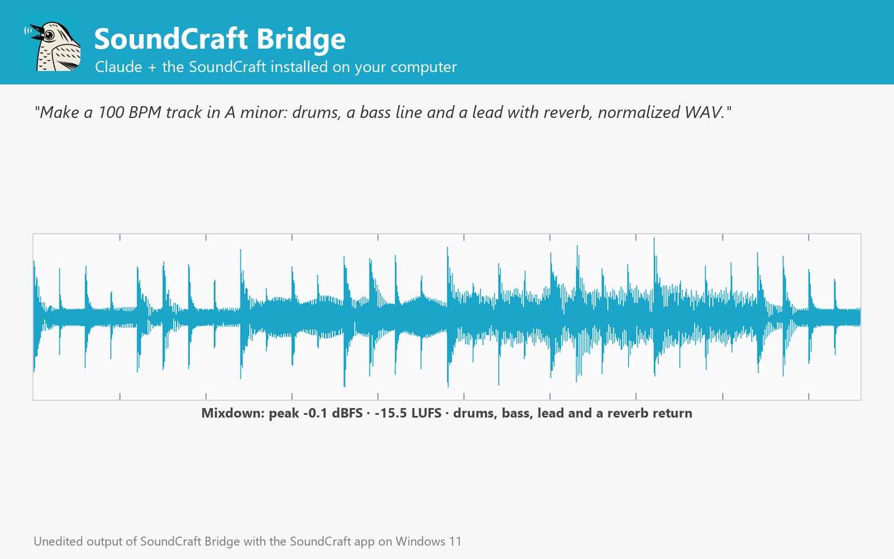

# SoundCraft Bridge

Make music and audio with the SoundCraft DAW installed on Windows, macOS or Linux: multitrack sessions from audio files and synth or drum notes, effects, busses, mixdowns with loudness, stems, MIDI, audio processing and conversion. Not affiliated with SoundCraft or Storytold.



Make music and audio with the SoundCraft you already have installed on Windows, macOS or Linux (tested with 0.6.1 on Windows 11), the open-source, Pro Tools-class digital audio workstation.

- **Create** multitrack sessions: audio tracks from files placed at any time (clip gain, fades), instrument tracks played by the built-in subtractive synth, General MIDI drum synth or a sampler from notes in beats, MIDI files, tempo, meter, key and markers.
- **Mix** with volume, pan, mute, solo, insert effects (EQ, compressor, gate, de-esser, maximizer, reverbs, delay, chorus, flanger, phaser, saturation, lo-fi) and sends to aux busses; every result shows a waveform picture and the peak and integrated loudness (LUFS).
- **Export** the mixdown to WAV, AIFF or FLAC, the stems, the MIDI and the editable .scraft session; edit existing sessions.
- **Process** audio files: trim, normalize, gain, reverse, pitch shift, time stretch, varispeed, effects and fades, one file or whole folders; convert between WAV, AIFF, FLAC, MP3, OGG, M4A, ALAC and CAF in.
- **Advanced**: run any of SoundCraft's 469 engine commands and open sessions in the SoundCraft app.

## Requirements

- **SoundCraft** installed on Windows, macOS or Linux, with its command-line engine `soundcraft-cli` ([SoundCraft releases](https://github.com/storytold/soundcraft/releases); on macOS also the separate `soundcraft-cli` zip). The plugin finds it in the standard install folders or on `PATH`; otherwise set its folder in the plugin settings.
- **Node.js 20 or later** on `PATH` (the plugin's MCP server runs with `node`).
- Claude Code or another Claude app that runs local MCP servers from plugins.

## Tools

| Tool | What it does |
| --- | --- |
| `create_session` | Build a multitrack song or mix: audio clips, synth and drum notes, effects, busses, markers |
| `edit_session` | Change a .scraft session: tracks, mixer, effects, tempo, markers |
| `export_session` | Mix down sessions to WAV, AIFF, FLAC, stems or MIDI with loudness |
| `process_audio` | Trim, normalize, pitch shift, time stretch and add effects to audio files |
| `convert_audio` | Convert audio to WAV, AIFF or FLAC, sample rate and bit depth |
| `get_audio_info` | Format, length, loudness (LUFS) and waveform of audio files and sessions |
| `list_soundcraft_catalog` | Engine commands, plugins with parameters, drum notes and formats |
| `run_soundcraft_commands` | Run any SoundCraft engine command, headless or in the live app |
| `open_in_soundcraft` | Open a session in the SoundCraft app |
| `get_soundcraft_status` | Check the SoundCraft installation, version and commands |

## Settings

All settings are optional; leave them empty to auto-detect.

| Setting | Title | Meaning |
| --- | --- | --- |
| `soundcraft_dir` | SoundCraft folder | Install folder of SoundCraft (or SoundCraft.app on macOS). Leave empty to auto-detect: C:\Program Files\SoundCraft, /Applications/SoundCraft.app, /usr/bin, /opt/soundcraft or PATH. |
| `soundcraft_cli` | soundcraft-cli executable (optional) | Only if it is somewhere else, e.g. where you unzipped the soundcraft-cli zip on macOS. |
| `control_port` | SoundCraft control port (optional) | Port used to drive the SoundCraft app (open_in_soundcraft, run_soundcraft_commands live). Default 7801. |

## What this plugin runs, reads and sends

- It starts one **local MCP server**: `node ${CLAUDE_PLUGIN_ROOT}/dist/bundle.cjs`. `dist/bundle.cjs` is the readable, unminified build of [jhonsu01/soundcraft-mcp-server](https://github.com/jhonsu01/soundcraft-mcp-server) version 1.0.0 (source code, tests and changelog are in that repository).
- The server runs the **SoundCraft engine installed on your computer** (`soundcraft-cli`) as a child process, one private engine per job in a temporary folder that is deleted afterwards. Only with `open_in_soundcraft` does it start the SoundCraft desktop app; with `control=true` that app listens on a loopback-only port on your own machine (`127.0.0.1`).
- It **reads only the files you name** (absolute paths) and **writes new files only where you ask**, never overwriting an existing file unless you set `overwrite: true`.
- It makes **no network requests**, sends no telemetry and stores no data. Its environment variables are only the settings above (`SOUNDCRAFT_DIR`, `SOUNDCRAFT_CLI`, `SOUNDCRAFT_CONTROL_PORT`).
- It installs nothing and runs no package manager: everything it needs is in this folder.

## Install

In Claude Code:

```
/plugin marketplace add jhonsu01/sunsam-plugins
/plugin install soundcraft-bridge@sunsam-plugins
```

The same connector is also available as a Claude Desktop extension (`.mcpb`), for Codex and DeepSeek Harness, and in the Sunsam Code marketplace: see [jhonsu01/soundcraft-mcp-server](https://github.com/jhonsu01/soundcraft-mcp-server).

## Support

Issues and questions: [https://github.com/jhonsu01/soundcraft-mcp-server/issues](https://github.com/jhonsu01/soundcraft-mcp-server/issues). Privacy: [PRIVACY.md](https://github.com/jhonsu01/sunsam-plugins/blob/main/PRIVACY.md).

## License

Apache-2.0. SoundCraft is an open-source project by Storytold (MIT or Apache-2.0). This plugin is a community project by Jhon Supelano; it is not affiliated with or endorsed by SoundCraft, Storytold or Anthropic.
