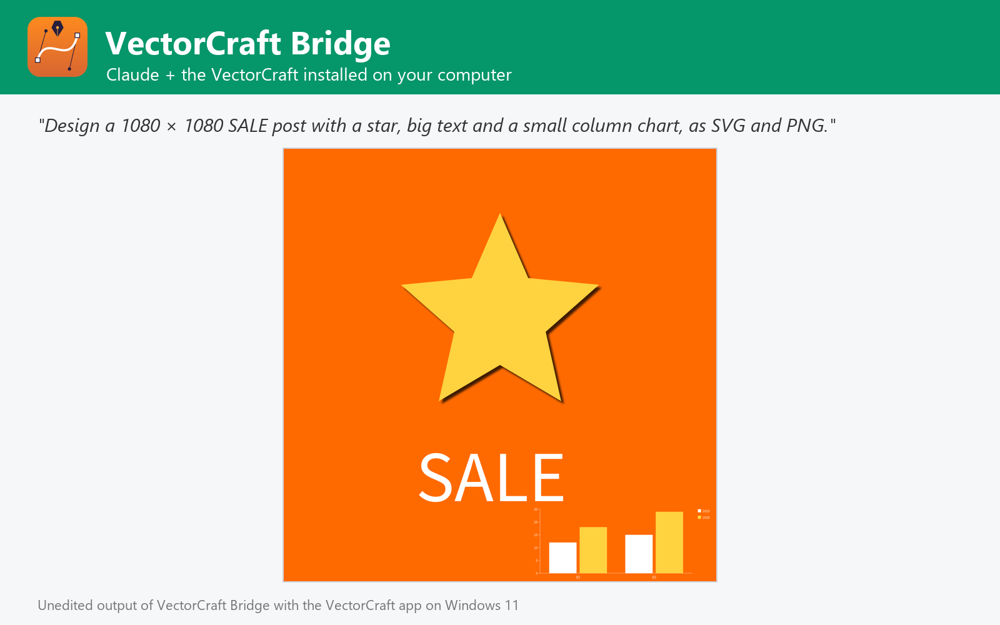

# VectorCraft Bridge

Vectorize images, convert between SVG, PDF, AI, EPS, DXF, PNG and more, create and recolor vector designs with shapes, text, charts and effects, using the VectorCraft editor installed on Windows, macOS or Linux. Not affiliated with VectorCraft or Storytold.



VectorCraft Bridge lets Claude work on vector artwork with the VectorCraft you already have installed on Windows, macOS or Linux (tested with 0.7.0), the open-source, Illustrator-class editor written in Rust.

- **Vectorize**: turn PNG / JPEG / TIFF / WebP images into clean vector art with Image Trace presets (logos, photos, line art, silhouettes) or your own colours, threshold, path and corner settings.
- **Convert**: read SVG, PDF, AI, EPS, DXF, EMF, WMF, .vectorcraft and bitmaps; write SVG, PDF, EPS, DXF, EMF, WMF, PNG, JPEG, WebP, GIF, TIFF, BMP, TGA, PSD with layers and more, several formats at once, one file per artboard.
- **Create**: documents of any size or preset with rectangles, ellipses, polygons, stars, lines, SVG paths, text, placed images and charts (column, bar, line, area, pie, radar), with fills, strokes, opacity and live effects (drop shadow, glow, roughen, warp, blur...).
- **Edit**: recolor by mapping colours, reduce colours, transform, apply effects, outline text, add elements, fit the artboard, set metadata.
- **Preview** any file, and run any of VectorCraft's 685 commands.

## Requirements

- **VectorCraft** installed on Windows, macOS or Linux, with its command-line engine `vectorcraft-cli` ([VectorCraft releases](https://github.com/storytold/vectorcraft/releases); on macOS also the separate `vectorcraft-cli` zip). The plugin finds it in the standard install folders or on `PATH`; otherwise set its folder in the plugin settings.
- **Node.js 20 or later** on `PATH` (the plugin's MCP server runs with `node`).
- Claude Code or another Claude app that runs local MCP servers from plugins.

## Tools

| Tool | What it does |
| --- | --- |
| `get_vector_info` | Artboards, colour mode, units, object counts, fonts, metadata |
| `convert_vector` | Convert between 20 vector and raster formats, per artboard |
| `vectorize_image` | Image Trace bitmaps into SVG, PDF, EPS... |
| `create_design` | New artwork from shapes, paths, text, images, coloured charts and effects |
| `edit_vector` | Recolor, reduce colours, transform, effects, outlines, add elements |
| `render_preview` | Render an artboard to PNG and show it |
| `list_vector_catalog` | Commands, effects, trace presets, document presets, formats |
| `run_vector_commands` | Run any VectorCraft engine tools, headless or in the live app |
| `open_in_vectorcraft` | Open files in the VectorCraft app |
| `get_vectorcraft_status` | Check the VectorCraft installation and version |

## Settings

All settings are optional; leave them empty to auto-detect.

| Setting | Title | Meaning |
| --- | --- | --- |
| `vectorcraft_dir` | VectorCraft folder | Install folder of VectorCraft (or VectorCraft.app on macOS). Leave empty to auto-detect: C:\Program Files\VectorCraft, /Applications/VectorCraft.app, /usr/bin, /opt/vectorcraft or PATH. |
| `vectorcraft_cli` | vectorcraft-cli executable (optional) | Only if it is somewhere else, e.g. where you unzipped vectorcraft-cli-<version>-macos-universal.zip on macOS. |
| `control_port` | VectorCraft control port (optional) | Port used to drive the VectorCraft app (run_vector_commands live). Default 7979. |

## What this plugin runs, reads and sends

- It starts one **local MCP server**: `node ${CLAUDE_PLUGIN_ROOT}/dist/bundle.cjs`. `dist/bundle.cjs` is the readable, unminified build of [jhonsu01/vectorcraft-mcp-server](https://github.com/jhonsu01/vectorcraft-mcp-server) version 1.0.5 (source code, tests and changelog are in that repository).
- The server runs the **VectorCraft engine installed on your computer** (`vectorcraft-cli`) as a child process, one private engine per job in a temporary folder that is deleted afterwards. Only with `open_in_vectorcraft` does it start the VectorCraft desktop app; with `control=true` that app listens on a loopback-only port on your own machine (`127.0.0.1`).
- It **reads only the files you name** (absolute paths) and **writes new files only where you ask**, never overwriting an existing file unless you set `overwrite: true`.
- It makes **no network requests**, sends no telemetry and stores no data. Its environment variables are only the settings above (`VECTORCRAFT_DIR`, `VECTORCRAFT_CLI`, `VECTORCRAFT_CONTROL_PORT`).
- It installs nothing and runs no package manager: everything it needs is in this folder.

## Install

In Claude Code:

```
/plugin marketplace add jhonsu01/sunsam-plugins
/plugin install vectorcraft-bridge@sunsam-plugins
```

The same connector is also available as a Claude Desktop extension (`.mcpb`), for Codex and DeepSeek Harness, and in the Sunsam Code marketplace: see [jhonsu01/vectorcraft-mcp-server](https://github.com/jhonsu01/vectorcraft-mcp-server).

## Support

Issues and questions: [https://github.com/jhonsu01/vectorcraft-mcp-server/issues](https://github.com/jhonsu01/vectorcraft-mcp-server/issues). Privacy: [PRIVACY.md](https://github.com/jhonsu01/sunsam-plugins/blob/main/PRIVACY.md).

## License

Apache-2.0. VectorCraft is an open-source project by Storytold (MIT or Apache-2.0). This plugin is a community project by Jhon Supelano; it is not affiliated with or endorsed by VectorCraft, Storytold or Anthropic.
