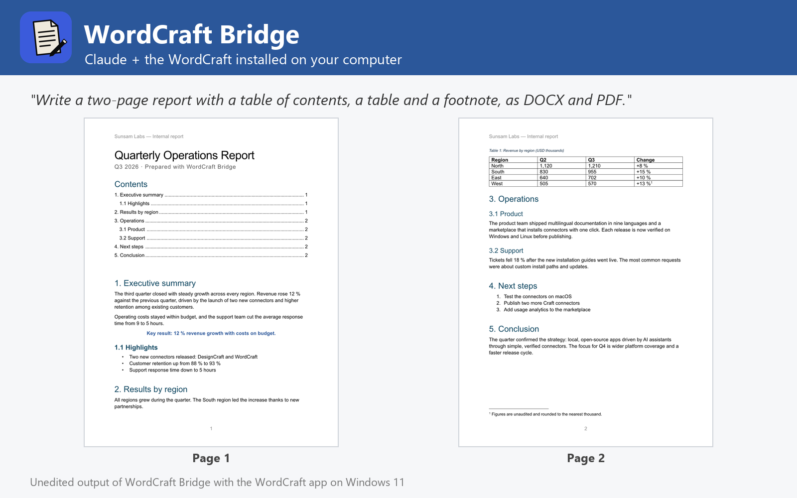

# WordCraft Bridge

Write, edit (find/replace, comments, tracked changes), mail-merge, convert and preview documents with the WordCraft word processor installed on Windows, macOS or Linux. Not affiliated with WordCraft or Storytold.



WordCraft Bridge lets Claude write and edit documents with the WordCraft you already have installed on Windows, macOS or Linux (tested with 0.6.1 on Windows 11), the open-source, Word-class word processor written in Rust.

- **Write** new documents from headings, paragraphs with styles and formatting, bullet and numbered lists, tables, images with captions, page breaks, a table of contents and footnotes, blank or from the letter, resume and report templates, with page size, margins, headers, footers and page numbers.
- **Edit** existing documents: find and replace (match case, whole word, wildcards), comments on any text, tracked changes so every edit is reviewable, accept or reject revisions, append content, remove personal information.
- **Mail merge** letters, certificates or notices from CSV, TSV, XLSX or ODS, with a template or a body written with {{Field}} placeholders.
- **Convert** between DOCX, DOC (read), PDF, ODT, RTF, HTML, Markdown, LaTeX, TXT and PNG, optionally with comments and changes printed (Print Markup).
- **Inspect**: page and word counts, properties, structure, plain text and page previews.
- **Advanced**: run any of WordCraft's 615 engine commands and open results in the WordCraft app.

## Requirements

- **WordCraft** installed on Windows, macOS or Linux, with its command-line engine `wordcraft-cli` ([WordCraft releases](https://github.com/storytold/wordcraft/releases); on macOS also the separate `wordcraft-cli` zip). The plugin finds it in the standard install folders or on `PATH`; otherwise set its folder in the plugin settings.
- **Node.js 20 or later** on `PATH` (the plugin's MCP server runs with `node`).
- Claude Code or another Claude app that runs local MCP servers from plugins.

## Tools

| Tool | What it does |
| --- | --- |
| `create_document` | Write a new document: headings, lists, tables, images, table of contents, headers, footers |
| `edit_document` | Find and replace, comments, tracked changes and appended content on existing documents |
| `mail_merge` | Personalized letters from a CSV or spreadsheet (template or {{Field}} body) |
| `convert_document` | Convert between docx, doc, pdf, odt, rtf, html, md, tex, txt and png |
| `get_document_info` | Pages, words, comments, tracked changes, properties and structure |
| `extract_text` | Plain text of one or many documents |
| `render_pages` | Render document pages to PNG |
| `list_wordcraft_catalog` | Engine commands, styles, templates and formats |
| `run_wordcraft_commands` | Run any WordCraft engine command, headless or in the live app |
| `open_in_wordcraft` | Open documents in the WordCraft app |
| `get_wordcraft_status` | Check the WordCraft installation, version and commands |

## Settings

All settings are optional; leave them empty to auto-detect.

| Setting | Title | Meaning |
| --- | --- | --- |
| `wordcraft_dir` | WordCraft folder | Install folder of WordCraft (or WordCraft.app on macOS). Leave empty to auto-detect: C:\Program Files\WordCraft, /Applications/WordCraft.app, /usr/bin, /opt/wordcraft or PATH. |
| `wordcraft_cli` | wordcraft-cli executable (optional) | Only if it is somewhere else, e.g. where you unzipped the wordcraft-cli zip on macOS. |
| `control_port` | WordCraft control port (optional) | Port used to drive the WordCraft app (open_in_wordcraft, run_wordcraft_commands live). Default 7985. |

## What this plugin runs, reads and sends

- It starts one **local MCP server**: `node ${CLAUDE_PLUGIN_ROOT}/dist/bundle.cjs`. `dist/bundle.cjs` is the readable, unminified build of [jhonsu01/wordcraft-mcp-server](https://github.com/jhonsu01/wordcraft-mcp-server) version 1.0.1 (source code, tests and changelog are in that repository).
- The server runs the **WordCraft engine installed on your computer** (`wordcraft-cli`) as a child process, one private engine per job in a temporary folder that is deleted afterwards. Only with `open_in_wordcraft` does it start the WordCraft desktop app; with `control=true` that app listens on a loopback-only port on your own machine (`127.0.0.1`).
- It **reads only the files you name** (absolute paths) and **writes new files only where you ask**, never overwriting an existing file unless you set `overwrite: true`.
- It makes **no network requests**, sends no telemetry and stores no data. Its environment variables are only the settings above (`WORDCRAFT_DIR`, `WORDCRAFT_CLI`, `WORDCRAFT_CONTROL_PORT`).
- It installs nothing and runs no package manager: everything it needs is in this folder.

## Install

In Claude Code:

```
/plugin marketplace add jhonsu01/sunsam-plugins
/plugin install wordcraft-bridge@sunsam-plugins
```

The same connector is also available as a Claude Desktop extension (`.mcpb`), for Codex and DeepSeek Harness, and in the Sunsam Code marketplace: see [jhonsu01/wordcraft-mcp-server](https://github.com/jhonsu01/wordcraft-mcp-server).

## Support

Issues and questions: [https://github.com/jhonsu01/wordcraft-mcp-server/issues](https://github.com/jhonsu01/wordcraft-mcp-server/issues). Privacy: [PRIVACY.md](https://github.com/jhonsu01/sunsam-plugins/blob/main/PRIVACY.md).

## License

Apache-2.0. WordCraft is an open-source project by Storytold (MIT or Apache-2.0). This plugin is a community project by Jhon Supelano; it is not affiliated with or endorsed by WordCraft, Storytold or Anthropic.
